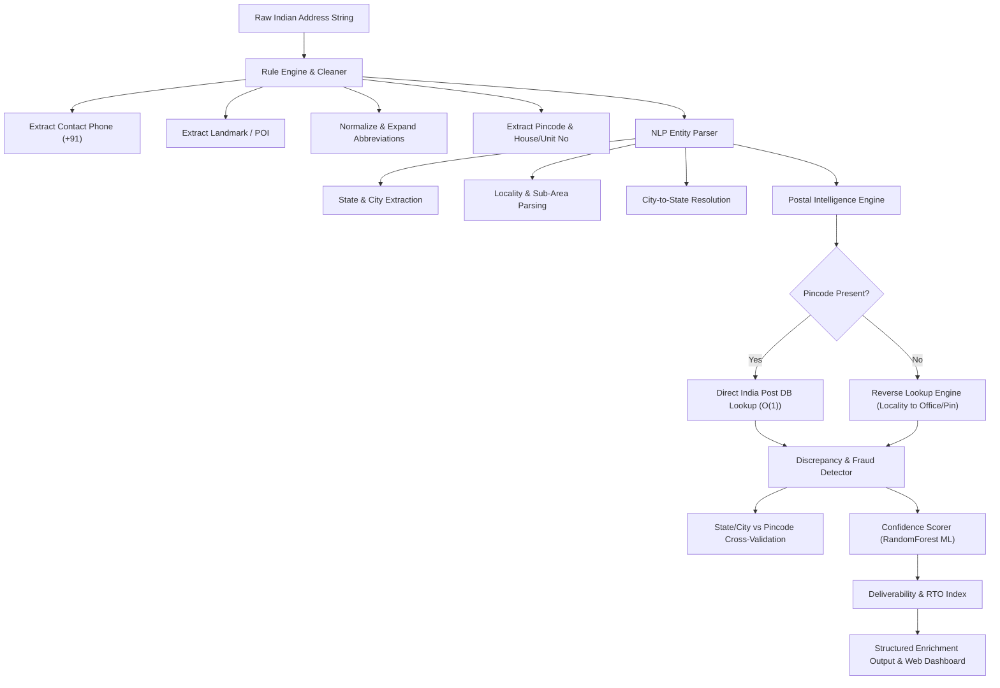

# AddressIQ — AI-Powered Address Cleaning, Enrichment & Intelligence System

[](https://www.python.org/)
[](https://flask.palletsprojects.com/)
[](https://scikit-learn.org/)
[](https://github.com/maxbachmann/RapidFuzz)
[](https://data.gov.in/)

An industry-grade **AI + NLP + Postal Intelligence System** engineered specifically for the complexity of Indian addresses. AddressIQ cleans, standardizes, validates, and enriches unstructured addresses for logistics, e-commerce, fintech, and KYC operations.

---

## 🌟 Key Features

### 1. Smart Reverse Postal Inference (Missing Pincode Resolution)
- Overcomes the limitation of strict one-way lookups. When an address lacks a postal code, AddressIQ executes **sub-millisecond reverse lookups** across **165,000+ India Post offices**.
- Infers probable **6-digit PIN code**, **district**, **state**, and **precise geocoordinates** from localities and sub-areas (e.g., *Dwarka*, *Koramangala*, *Andheri West*).

### 2. KYC & Fraud Shield (Cross-Validation Discrepancy Detector)
- Protects e-commerce and logistics networks from expensive **RTO (Return-to-Origin)** misrouting.
- Detects geographic contradictions between user text and postal PIN codes:
  - **`STATE_MISMATCH` (CRITICAL)**: Flags addresses where text geography conflicts with postal routing (e.g., *"Bangalore, Karnataka - 110001"* where `110001` belongs to New Delhi).
  - **`CITY_MISMATCH` (WARNING)**: Catches district/city misalignments (e.g., *"Pune - 400001"*).
  - **`INVALID_PINCODE` (HIGH)**: Rejects unregistered/fabricated 6-digit codes.

### 3. Logistics Deliverability & RTO Risk Predictor
- Designed for last-mile couriers (Delhivery, BlueDart, Ekart, Swiggy, Zomato).
- Evaluates doorstep deliverability via a **6-Factor Readiness Checklist**:
  1. House / Flat / Door Unit Identified
  2. Locality / Sub-Area Resolved
  3. Navigational Landmark / POI Extracted
  4. Postal PIN Code Validated
  5. Delivery Phone Contact Available
  6. GPS Geocoordinates Available
- Classifies parcels into deliverability personas: `LAST_MILE_READY`, `HUB_LEVEL_ONLY`, `CRITICAL_CONFLICT`, or `UNROUTABLE`.
- Generates automated dispatch recommendations and calculates first-attempt delivery success probabilities.

### 4. Syntactic Extraction (Phone Numbers & Landmarks)
- **Contact Number Isolator**: Automatically extracts 10-digit Indian mobile numbers (`+91-XXXXXXXXXX`) and strips them *before* digit parsing, preventing number pollution of house numbers or pincodes.
- **Landmark & POI Extractor**: Isolates directional markers (`near ...`, `opp ...`, `behind ...`, `next to ...`) into dedicated structured fields.

### 5. Non-Greedy Fuzzy NLP Matching
- Standardizes 700+ Indian districts and 36 states/UTs.
- Token-count aligned sliding-window matching prevents multi-word phrases from swallowing adjacent numbers or locality terms.
- Built-in regional alias map (`blr` $\to$ Bengaluru Urban, `bombay` $\to$ Mumbai, `calcutta` $\to$ Kolkata, `gurgaon` $\to$ Gurugram).

### 6. Balanced RandomForest ML Confidence Scoring
- Multi-factor regressor trained on balanced synthetic distributions.
- Scores addresses from **0 to 100** categorized into **`HIGH`** ($\ge 75$), **`MEDIUM`** ($45 - 74$), and **`LOW`** ($< 45$).
- Addresses lacking pincodes can still reach `HIGH` or `MEDIUM` if other structural fields are complete.

---

## 🏗 System Architecture



---

## 📁 Project Structure

```text
AI_Powered_AddressCleaning_EnrichmentSystem/
├── data/
│   ├── india_post_pincode.csv      # 165K+ India Post postal records
│   └── confidence_model.pkl        # Trained RandomForest ML model
├── templates/
│   └── index.html                  # Responsive dark-mode dashboard
├── app.py                          # Flask REST API server (/clean, /batch)
├── rule_engine.py                  # Text normalization, phone & landmark extraction
├── nlp_parser.py                   # Fuzzy NLP entity parser (cities, states, localities)
├── pincode_lookup.py               # Postal DB lookup, reverse lookup & geocoding
├── discrepancy_detector.py         # Cross-validation & fraud conflict shield
├── deliverability_index.py         # 6-factor deliverability & RTO risk predictor
├── confidence_score.py             # Balanced ML confidence scoring
├── pipeline.py                     # Unified end-to-end processing pipeline
├── eda.py                          # Exploratory data analysis charts
└── requirements.txt                # Project dependencies
```

---

## 🚀 Quickstart Guide

### 1. Prerequisites
- Python 3.10 or higher
- Git

### 2. Installation
```bash
# Clone the repository
git clone https://github.com/dev-tanishq12/address-cleaning-enrichment.git
cd address-cleaning-enrichment

# Create and activate virtual environment
python -m venv .venv
# Windows:
.\.venv\Scripts\activate
# Linux/macOS:
source .venv/bin/activate

# Install dependencies
pip install -r requirements.txt
```

### 3. Dataset Setup
Download the India Post PIN code directory (`india_post_pincode.csv`) and place it inside the `data/` directory.

### 4. Configure Gemini (optional)

Gemini uses Google's supported `google-genai` Python SDK and is configured by the server operator; dashboard users only need to enter an address. Open the repository's `.env` file and paste your key after `GEMINI_API_KEY=`. The app loads `.env` on startup, and `.env` is excluded from Git. Never commit or share the populated file. `.env.example` shows the expected format.

Windows PowerShell:
```powershell
$env:GEMINI_API_KEY = "YOUR_GEMINI_API_KEY"
```

Linux/macOS:
```bash
export GEMINI_API_KEY="YOUR_GEMINI_API_KEY"
```

If the key is missing, invalid, unavailable, or rate-limited, AddressIQ continues cleaning addresses with its local NLP fallback. Invalid-key and quota/rate-limit failures disable further Gemini requests for the current server process to avoid repeating failed calls. Restart Flask after editing `.env` or after the underlying Gemini issue is resolved.

### 5. Train Confidence Model & Run Server
```bash
# Train the RandomForest confidence scoring model
python confidence_score.py

# Start the Flask web application
python app.py
```
Open **`http://127.0.0.1:5000`** in your browser.

---

## ⚡ CLI & Pipeline Usage

Process an individual address directly from your terminal:
```bash
python pipeline.py --address "Flat no 12, Sec 17 Dwarka, near metro station, Delhi - 110078 call 9876543210"
```

**Output:**
```text
  raw_address        : Flat no 12, Sec 17 Dwarka, near metro station, Delhi - 110078 call 9876543210
  normalized_address : flat no 12 sector 17 dwarka delhi - 110078
  house_no           : flat no 12
  locality           : Sector 17
  landmark           : Near Metro Station
  phone_number       : +91-9876543210
  city               : New Delhi
  district           : South West
  state              : Delhi
  pincode            : 110078 (provided)
  coordinates        : (28.6102, 77.0376)
  confidence_score   : 99 (HIGH)
  scoring_method     : ml
  deliverability     : LAST_MILE_READY (RTO Risk: LOW - 95% success)
  dispatch_action    : Direct Dispatch: High probability of first-attempt doorstep delivery success.
  delivery_checks    : 6/6 passed
  notes              : Pincode 110078 verified via India Post DB
```

---

## 📡 REST API Reference

### 1. Clean Single Address
- **Endpoint**: `POST /clean`
- **Headers**: `Content-Type: application/json`
- **Request Body**:
```json
{
  "address": "12/B Andheri w mmbai next to reliance fresh mob 9811223344"
}
```
- **Response**:
```json
{
  "raw_address": "12/B Andheri w mmbai next to reliance fresh mob 9811223344",
  "normalized_address": "12/b andheri west mumbai",
  "house_no": "12/b",
  "locality": "Andheri West",
  "landmark": "Next To Reliance Fresh",
  "phone_number": "+91-9811223344",
  "city": "Mumbai",
  "district": "Mumbai Suburban",
  "state": "Maharashtra",
  "pincode": "400058",
  "pincode_source": "inferred",
  "pincode_validated": true,
  "latitude": 19.12128,
  "longitude": 72.84623,
  "confidence_score": 93,
  "confidence_tier": "HIGH",
  "scoring_method": "ml",
  "deliverability": {
    "deliverability_tier": "LAST_MILE_READY",
    "rto_risk": "LOW",
    "estimated_success_rate": 95,
    "dispatch_action": "Direct Dispatch: High probability of first-attempt doorstep delivery success.",
    "checklist_passed": 6,
    "checklist_total": 6
  },
  "discrepancy": {
    "has_conflict": false,
    "status": "NO_PINCODE",
    "severity": "INFO"
  }
}
```

### 2. Batch Processing
- **Endpoint**: `POST /batch`
- **Request Body**:
```json
{
  "addresses": [
    "Flat no 12, Sec 17 Dwarka, Delhi - 110078",
    "H-34 kormangla 5th blk blr",
    "Flat 12, MG Road, Bangalore 110001"
  ]
}
```
- **Response**: Returns an array of processed address objects along with summary statistics (`total`, `high`, `medium`, `low`, `avg_score`).

---

## 📊 Before vs After Optimization

| Input Address | Prior Behavior | AddressIQ Enhanced Behavior |
| :--- | :--- | :--- |
| `"H-34 kormangla 5th blk blr"` *(No pincode)* | Pincode: `None`<br>Locality: `None`<br>State: `None`<br>**Score: 15 (LOW)** | Pincode: **`560034` (Inferred)**<br>Locality: **`Koramangala 5Th Block`**<br>State: **`Karnataka`**<br>**Score: 93 (HIGH)** |
| `"12/B Andheri w mmbai next to reliance fresh call 9811223344"` | Phone & landmark not isolated<br>Pincode: `None`<br>**Score: 15 (LOW)** | Phone: **`+91-9811223344`**<br>Landmark: **`Next To Reliance Fresh`**<br>Pincode: **`400058` (Inferred)**<br>**Score: 93 (HIGH)** |
| `"Flat 12, Bangalore 110001"` *(Conflicting State)* | Conflicting pincode treated as valid<br>**Score: 90+ (False High)** | Catches **`CRITICAL STATE_MISMATCH`**<br>Penalizes score to **35 (LOW)**<br>Flags high RTO misrouting risk |

---

## 🛠 Tech Stack
- **Backend & Core Logic**: Python 3.10+, Flask
- **Machine Learning**: Scikit-Learn (RandomForestRegressor), NumPy
- **NLP & String Matching**: RapidFuzz, Regular Expressions (Regex)
- **Data Engineering**: Pandas
- **Frontend Dashboard**: HTML5, Vanilla JavaScript, CSS3 (Custom Dark Theme with Syne & JetBrains Mono typography)

---

## 📄 License
This project is licensed under the MIT License.
